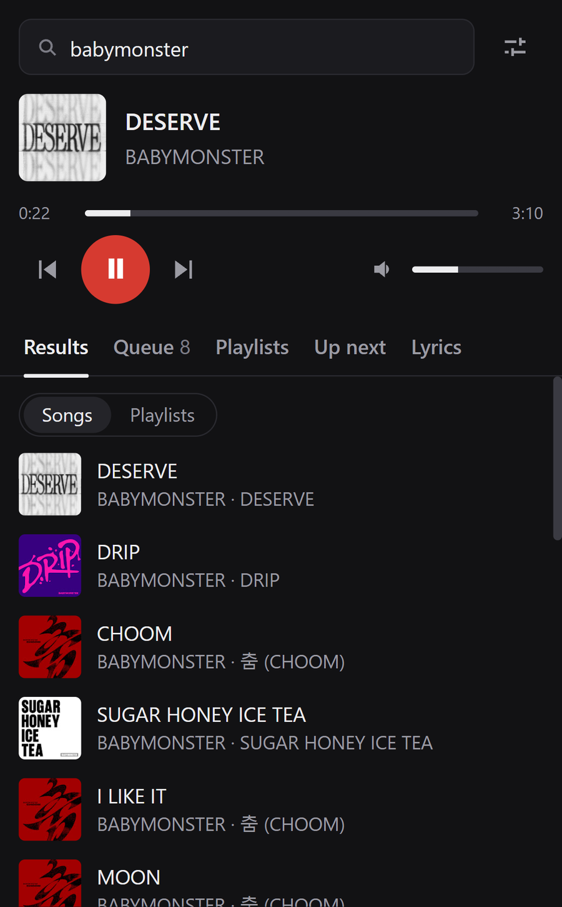
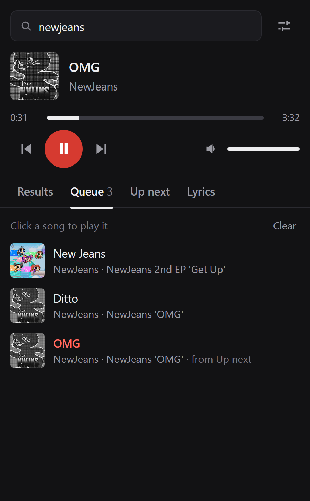

# PocketBeat

Search, play, queue, and sing along to YouTube Music songs right from your browser toolbar, without
opening a YouTube Music tab and without an API key.

<p>
  
  
</p>

## Features

- **Song search from YouTube Music.** Results are song versions with album art, artist, and album,
  not music videos. No API key, no quota.
- **Search suggestions as you type.** Up to 4 suggestions from YouTube Music. Use ↓/↑ to pick one, →
  to put it in the search box and keep typing, Enter to search, Esc to close.
- **Plays in the background.** Music keeps playing after you close the popup. No tab is opened.
- **Queue.** Play now, add to queue, remove, clear.
- **Up next.** Suggestions come from the YouTube Music radio for the current song. When the queue ends,
  PocketBeat keeps playing from that radio, the same way YouTube Music does.
- **Synced lyrics** from [LRCLIB](https://lrclib.net), highlighted line by line.
- **Seek bar, volume, and mute**, with the volume remembered between songs.

## Install

PocketBeat is not on the Chrome Web Store. Install it manually:

1. Download `pocketbeat-<version>.zip` from the [latest release](https://github.com/muhamadsyahrulmubarok/pocketbeat/releases/latest)
   and unzip it. (Or clone this repository.)
2. Open `chrome://extensions` and turn on **Developer mode** (top right).
3. Click **Load unpacked** and select the unzipped folder.
4. Pin PocketBeat to the toolbar, open it, and search for a song.

Works in Chrome 116+ and other Chromium browsers (Edge, Brave, Opera).

To update, replace the folder with the new release and click the reload icon on the extension's card in
`chrome://extensions`.

## How it works

```
popup ──commands──▶ service worker ──LOAD / TOGGLE / SEEK──▶ offscreen document
  ▲                 (queue, search,                          └─ YouTube embed iframe
  └── STATE / PLAYER_STATUS ── suggestions, lyrics) ◀── status, ended, errors ──┘
```

| Part | File | Role |
|------|------|------|
| Popup | `popup/` | The UI. A remote control only: it holds no playback state. |
| Service worker | `background/service-worker.js` | Search, suggestions, lyrics, the queue, auto-advance. |
| Offscreen document | `offscreen/` | A hidden page that survives the popup closing. It hosts a YouTube embed iframe, driven through the IFrame API `postMessage` protocol (the `iframe_api` script itself can't be loaded in Manifest V3). |

A few details worth knowing:

- **Search and Up next** call the same internal endpoints music.youtube.com uses
  (`/youtubei/v1/search` and `/youtubei/v1/next`), like other open source YouTube Music clients do.
- **Request headers.** Extension pages send no `Referer`, and YouTube refuses embeds without one
  (Error 153). A `declarativeNetRequest` rule adds a `Referer` to embed requests, and sets
  `Origin`/`Referer` to music.youtube.com for the search requests. Both rules only match requests made by
  the extension itself.
- **Songs that can't be embedded** (the owner disallows playback outside YouTube) are skipped
  automatically.

## Optional: YouTube Data API key

Not needed. If the YouTube Music search ever breaks, you can add a
[YouTube Data API v3](https://developers.google.com/youtube/v3/getting-started) key in the popup's settings
(the sliders icon) as a fallback. Fallback results are regular YouTube videos, and each search costs 100 of
the free 10,000 daily quota units. The key is stored only in your browser.

## Limitations

- **Unofficial API.** YouTube Music's internal API is undocumented and can change at any time, which would
  break search and Up next until PocketBeat is updated.
- **Ads.** Playback goes through the standard YouTube embed, so YouTube may play ads.
- **Idle player.** Chrome closes the hidden player after about 30 seconds without audio (for example a long
  pause). Pressing play resumes from where you left off.
- **Lyrics** depend on LRCLIB; not every song has synced lyrics.

## Privacy

PocketBeat has no servers, no analytics, and no accounts. Your queue, history, and settings stay in your
browser. See [PRIVACY.md](PRIVACY.md) for exactly what is sent where.

## Development

No build step: the extension is plain HTML, CSS, and JavaScript. Node.js 22.2+ is only needed for the
tooling.

```bash
npm install        # dev tooling (ESLint)
npm test           # lint + manifest/file checks
npm run package    # builds dist/pocketbeat-<version>.zip
```

Load the repository folder with **Load unpacked** while developing. See
[CONTRIBUTING.md](CONTRIBUTING.md) before opening a pull request.

## Disclaimer

PocketBeat is an independent project. It is not affiliated with, endorsed by, or sponsored by YouTube or
Google. "YouTube" and "YouTube Music" are trademarks of Google LLC. Use PocketBeat in line with the
[YouTube Terms of Service](https://www.youtube.com/t/terms).

## License

[MIT](LICENSE) © muhamadsyahrulmubarok. Lyrics are provided by [LRCLIB](https://lrclib.net).
